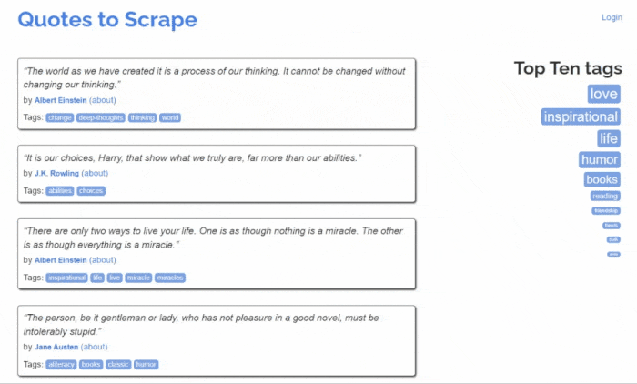
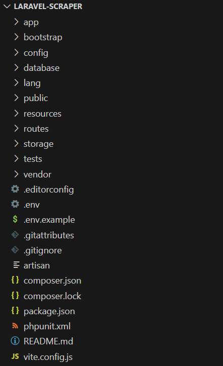
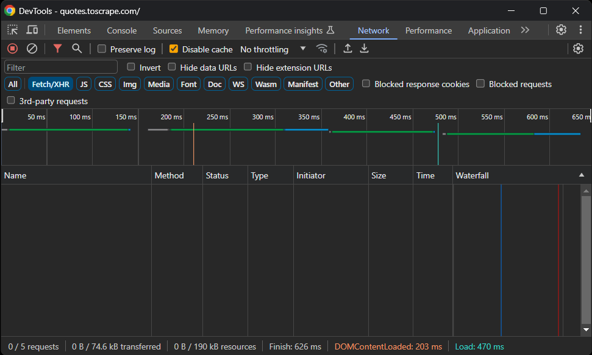
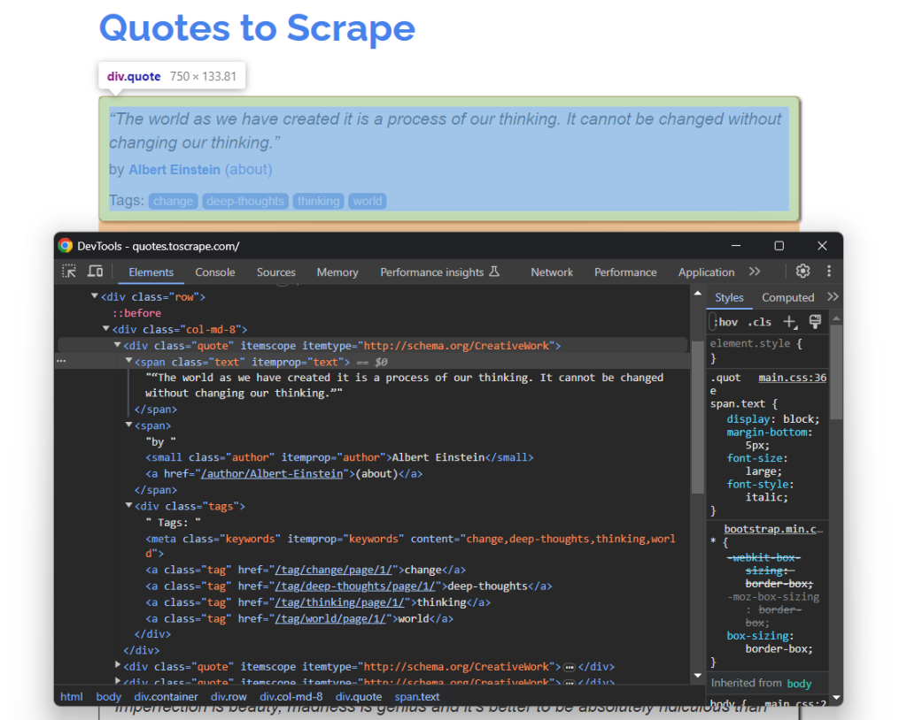

# 使用 Laravel 进行网页爬虫

[](https://www.bright.cn/) 

本指南介绍如何使用 Laravel 进行网页爬虫：

- [前提条件](#前提条件)
- [如何在 Laravel 中构建网页爬虫 API](#如何在-laravel-中构建网页爬虫-api)
  - [第 1 步：设置 Laravel 项目](#第-1-步设置-laravel-项目)
  - [第 2 步：初始化爬虫 API](#第-2-步初始化爬虫-api)
  - [第 3 步：安装抓取库](#第-3-步安装抓取库)
  - [第 4 步：下载目标页面](#第-4-步下载目标页面)
  - [第 5 步：检查页面内容](#第-5-步检查页面内容)
  - [第 6 步：为执行网页爬虫做好准备](#第-6-步为执行网页爬虫做好准备)
  - [第 7 步：实现数据抓取](#第-7-步实现数据抓取)
  - [第 8 步：返回抓取的数据](#第-8-步返回抓取的数据)
  - [第 9 步：整合所有代码](#第-9-步整合所有代码)
- [后续步骤](#后续步骤)

## 能否在 Laravel 中执行网页爬虫？

[Laravel](https://laravel.com/) 是一个功能强大且语法优雅的 PHP 框架，非常适合构建网页爬虫 API。它支持多种抓取库，可以简化数据提取。 

Laravel 具备出色的可扩展性、便捷的集成方式和强大的 MVC 架构，可让抓取逻辑保持井然有序，因此非常适合复杂或大规模项目。有关更多详细信息，请参阅我们的 [PHP 网页爬虫](https://www.bright.cn/blog/how-tos/web-scraping-php)指南。

## 最佳 Laravel 网页爬虫库

以下是一些适用于 Laravel 网页爬虫的优秀库：

- [**BrowserKit**](https://github.com/symfony/browser-kit)：一个 Symfony 组件，可模拟用于与静态 HTML 文档交互的网页浏览器 API。它与 `DomCrawler` 配合使用，可实现高效的导航和抓取。
- [**HttpClient**](https://github.com/symfony/http-client)：一个可与 `BrowserKit` 无缝集成以发送请求的 Symfony HTTP 客户端。
- [**Guzzle**](https://github.com/guzzle/guzzle)：一个功能强大的 HTTP 客户端，用于发出网页请求和处理响应，适合检索 HTML 文档。了解[如何在 Guzzle 中设置代理](https://www.bright.cn/blog/how-tos/proxy-with-guzzle)。
- [**Panther**](https://github.com/symfony/panther)：一款无头浏览器，用于抓取需要 JavaScript 渲染或交互的动态网站。
## 前提条件

要学习本 Laravel 网页爬虫教程，你需要满足以下前提条件：

- [PHP 8+](https://www.php.net/downloads.php)
- [Composer](https://getcomposer.org/download/)

此外，建议使用支持 PHP 编程的 IDE。

## 如何在 Laravel 中构建网页爬虫 API

本节将指导你使用 [Quotes 抓取沙盒网站](https://quotes.toscrape.com/)创建 Laravel 网页爬虫 API。该抓取端点将：

1. 从页面中选择引文 HTML 元素  
2. 从中提取数据  
3. 以 JSON 格式返回抓取的数据  

目标网站如下所示：



### 第 1 步：设置 Laravel 项目

打开终端并运行以下 Composer [`create-command`](https://getcomposer.org/doc/03-cli.md#create-project) 命令，初始化 Laravel 网页爬虫应用：

```bash
composer create-project laravel/laravel laravel-scraper
```

此时，`lavaral-scraper` 文件夹中将包含一个空白的 Laravel 项目。使用你常用的 PHP IDE 打开它。

以下是当前后端的文件结构：



### 第 2 步：初始化爬虫 API

在项目目录中运行以下 [Artisan 命令](https://laravel.com/docs/11.x/artisan)，添加一个新的 Laravel 控制器：

```bash
php artisan make:controller HelloWorldController
```

这将在 `/app/Http/Controllers` 目录中创建以下 `ScrapingController.php` 文件：

```php
<?php

namespace App\Http\Controllers;

use Illuminate\Http\Request;

class ScrapingController extends Controller

{

//

}
```

在 `ScrapingController` 文件中添加以下 `scrapeQuotes()` 方法：

```
public function scrapeQuotes(): JsonResponse

{

// scraping logic...

return response()->json('Hello, World!');

}
```

目前，该方法会返回一条占位用的 `'Hello, World!'` JSON 消息。

添加以下导入：

```php
use Illuminate\Http\JsonResponse;
```

通过向 `routes/api.php` 添加以下代码行，将 `scrapeQuotes()` 方法与专用端点关联：

```php
use App\Http\Controllers\ScrapingController;

Route::get('/v1/scraping/scrape-quotes', [ScrapingController::class, 'scrapeQuotes']);
```

验证 Laravel 抓取 API 是否按预期运行。由于 Laravel API 位于 `/api` 路径下，因此完整的 API 端点是 `/api/v1/scraping/scrape-quotes`。

启动 Laravel 应用：

```php
php artisan serve
```

服务器现在应在本地监听 `8000` 端口。

使用 cURL 向 `/api/v1/scraping/scrape-quotes` 端点发出 `GET` 请求：

```bash
curl -X GET 'http://localhost:8000/api/v1/scraping/scrape-quotes'
```

你应会收到以下响应：

```
"Hello, World!"
```

### 第 3 步：安装抓取库

安装任何软件包之前，请确定哪些 Laravel 网页爬虫库适合你的需求。打开目标网站，使用开发者工具进行检查，然后查看 **Network → Fetch/XHR** 部分：



由于该网站不会发出 [AJAX 请求](https://developer.mozilla.org/en-US/docs/Web/Guide/AJAX)，因此它是一个数据嵌入 HTML 中的静态页面。无需使用[无头浏览器](https://www.bright.cn/blog/web-data/best-headless-browsers)，否则会增加额外开销。

为了高效抓取，请使用 Symfony 的 [`BrowserKit`](https://symfony.com/doc/current/http_client.html) 和 [`HttpClient`](https://symfony.com/doc/current/http_client.html)。使用以下命令安装：

```bash
composer require symfony/browser-kit symfony/http-client
```

### 第 4 步：下载目标页面

在 `ScrapingController` 中导入 `BrowserKit` 和 `HttpClient`：

```php
use Symfony\Component\BrowserKit\HttpBrowser;

use Symfony\Component\HttpClient\HttpClient;
```

在 `scrapeQuotes()` 中初始化一个新的 `HttpBrowser` 对象：

```php
$browser = new HttpBrowser(HttpClient::create());
```

`HttpBrowser` 可让你在模拟浏览器行为的同时发出 HTTP 请求，包括处理 Cookie 和会话。不过，它不会在真实浏览器中执行请求。

使用 `request()` 方法向目标 URL 发出 HTTP GET 请求：

```php
$crawler = $browser->request('GET', 'https://quotes.toscrape.com/');
```

结果将是一个 [`Crawler`](https://github.com/symfony/symfony/blob/7.1/src/Symfony/Component/DomCrawler/Crawler.php) 对象，它会自动解析服务器返回的 HTML 文档。该类还提供节点选择和数据提取功能。

你可以从爬虫中提取页面 HTML，以验证上述逻辑是否正常工作：

```
$html = $crawler->outerHtml();
```

为了进行测试，让 API 返回这些数据。

你的 `scrapeQuotes()` 函数现在如下所示：

```php
public function scrapeQuotes(): JsonResponse

{

// initialize a browser-like HTTP client

$browser = new HttpBrowser(HttpClient::create());

// download and parse the HTML of the target page

$crawler = $browser->request('GET', 'https://quotes.toscrape.com/');

// get the page outer HTML and return it

$html = $crawler->outerHtml();

return response()->json($html);

}
```

API 现在将返回：

```html
<!DOCTYPE html>

<html lang="en">

<head>

<meta charset="UTF-8">

<title>Quotes to Scrape</title>

<link rel="stylesheet" href="/static/bootstrap.min.css">

<link rel="stylesheet" href="/static/main.css">

</head>

<!-- omitted for brevity ... -->
```

### 第 5 步：检查页面内容

要定义提取逻辑，请检查目标页面的 HTML 结构。

1. 打开 [Quotes To Scrape](https://quotes.toscrape.com/)。  
2. 右键单击一个引文元素，然后在开发者工具中选择 **Inspect**。  
3. 展开 HTML 并检查其结构：



每个 `.quote` 元素都包含：  
- 一个用于引文文本的 `.text` 节点  
- 一个用于作者姓名的 `.author` 节点  
- 多个用于相关标签的 `.tag` 节点  

借助这些 [CSS 选择器](https://developer.mozilla.org/en-US/docs/Web/CSS/CSS_Selectors)，你现在可以在 Laravel 中提取所需数据。

### 第 6 步：为执行网页爬虫做好准备

创建一个用于存储抓取数据的数据结构。为此，请使用数组：

```php
quotes = []
```

现在，使用 `Crawler` 类中的 `filter()` 方法选择所有引文元素：

```php
$quote_html_elements = $crawler->filter('.quote');
```

这将返回页面上与指定 `.quote` CSS 选择器匹配的所有 DOM 节点。

接下来，遍历这些节点，并准备对每个节点应用数据提取逻辑：

```php
foreach ($quote_html_elements as $quote_html_element) {

// create a new quote crawler

$quote_crawler = new Crawler($quote_html_element);

// scraping logic...

}
```

`filter()` 返回的 `DOMNode` 对象缺少节点选择方法。要解决此问题，请创建一个作用域限定为特定 HTML 引文元素的本地 `Crawler` 实例。

为了让代码正常运行，请添加以下导入：

```php
use Symfony\Component\DomCrawler\Crawler;
```

### 第 7 步：实现数据抓取

在 `foreach` 循环中：

1. 从 `.text`、`.author` 和 `.tag` 元素中提取所需数据
2. 使用这些数据填充一个新的 `$quote` 对象
3. 将新的 `$quote` 对象添加到 `$quotes`

首先，选择 HTML 引文元素中的 .text 元素。然后，使用 `text()` 方法提取其中的内部文本：

```php
$text_html_element = $quote_crawler->filter('.text');

$raw_text = $text_html_element->text();
```

每条引文都由特殊字符 `\u201c` 和 `\u201d` 包围。你可以使用 PHP 的 [`str_replace()`](https://www.php.net/manual/en/function.str-replace.php) 函数将其移除，如下所示：

```php
$text = str_replace(["\u{201c}", "\u{201d}"], '', $raw_text);
```

同样，使用以下代码抓取作者信息：

```php
$author_html_element = $quote_crawler->filter('.author');

$author = $author_html_element->text();
```

抓取标签可能更具挑战性。由于一条引文可能有多个标签，因此你需要定义一个数组，并逐个抓取每个标签：

```php
$tag_html_elements = $quote_crawler->filter('.tag');

$tags = [];

foreach ($tag_html_elements as $tag_html_element) {

$tag = $tag_html_element->textContent;

$tags[] = $tag;

}
```

请注意，`filter()` 返回的 `DOMNode` 元素不提供 `text()` 方法。作为替代，它们提供了 `textContent` 属性。

以下是完整的 Laravel 数据抓取逻辑：

```php
// create a new quote crawler

$quote_crawler = new Crawler($quote_html_element);

// perform the data extraction logic

$text_html_element = $quote_crawler->filter('.text');

$raw_text = $text_html_element->text();

// remove special characters from the raw text information

$text = str_replace(["\u{201c}", "\u{201d}"], '', $raw_text);

$author_html_element = $quote_crawler->filter('.author');

$author = $author_html_element->text();

$tag_html_elements = $quote_crawler->filter('.tag');

$tags = [];

foreach ($tag_html_elements as $tag_html_element) {

$tag = $tag_html_element->textContent;

$tags[] = $tag;

}
```

### 第 8 步：返回抓取的数据

使用抓取的数据创建一个 `$quote` 对象，并将其添加到 `$quotes`：

```php
$quote = [

'text' => $text,

'author' => $author,

'tags' => $tags

];

$quotes[] = $quote;
```

接下来，使用 `$quotes` 列表更新 API 响应数据：

```php
return response()->json(['quotes' => $quotes]);
```

抓取循环结束时，`$quotes` 将包含：

```php
array(10) {

[0]=>

array(3) {

["text"]=>

string(113) "The world as we have created it is a process of our thinking. It cannot be changed without changing our thinking."

["author"]=>

string(15) "Albert Einstein"

["tags"]=>

array(4) {

[0]=>

string(6) "change"

[1]=>

string(13) "deep-thoughts"

[2]=>

string(8) "thinking"

[3]=>

string(5) "world"

}

}

// omitted for brevity...

[9]=>

array(3) {

["text"]=>

string(48) "A day without sunshine is like, you know, night."

["author"]=>

string(12) "Steve Martin"

["tags"]=>

array(3) {

[0]=>

string(5) "humor"

[1]=>

string(7) "obvious"

[2]=>

string(6) "simile"

}

}

}
```

随后，这些数据将被序列化为 JSON，并由 Laravel 抓取 API 返回。

### 第 9 步：整合所有代码

以下是 Laravel 中 `ScrapingController` 文件的最终代码：

```php
<?php

namespace App\Http\Controllers;

use Illuminate\Http\Request;

use Illuminate\Http\JsonResponse;

use Symfony\Component\BrowserKit\HttpBrowser;

use Symfony\Component\HttpClient\HttpClient;

use Symfony\Component\DomCrawler\Crawler;

class ScrapingController extends Controller

{

public function scrapeQuotes(): JsonResponse

{

// initialize a browser-like HTTP client

$browser = new HttpBrowser(HttpClient::create());

// download and parse the HTML of the target page

$crawler = $browser->request('GET', 'https://quotes.toscrape.com/');

// where to store the scraped data

$quotes = [];

// select all quote HTML elements on the page

$quote_html_elements = $crawler->filter('.quote');

// iterate over each quote HTML element and apply

// the scraping logic

foreach ($quote_html_elements as $quote_html_element) {

// create a new quote crawler

$quote_crawler = new Crawler($quote_html_element);

// perform the data extraction logic

$text_html_element = $quote_crawler->filter('.text');

$raw_text = $text_html_element->text();

// remove special characters from the raw text information

$text = str_replace(["\u{201c}", "\u{201d}"], '', $raw_text);

$author_html_element = $quote_crawler->filter('.author');

$author = $author_html_element->text();

$tag_html_elements = $quote_crawler->filter('.tag');

$tags = [];

foreach ($tag_html_elements as $tag_html_element) {

$tag = $tag_html_element->textContent;

$tags[] = $tag;

}

// create a new quote object

// with the scraped data

$quote = [

'text' => $text,

'author' => $author,

'tags' => $tags

];

// add the quote object to the quotes array

$quotes[] = $quote;

}

var_dump($quotes);

return response()->json(['quotes' => $quotes]);

}

}
```

现在进行测试。启动 Laravel 服务器：

```bash
php artisan serve
```

向 `/api/v1/scraping/scrape-quotes` 端点发出 GET 请求：

```bash
curl -X GET 'http://localhost:8000/api/v1/scraping/scrape-quotes'
```

你将获得以下结果：

```
{

"quotes": [

{

"text": "The world as we have created it is a process of our thinking. It cannot be changed without changing our thinking.",

"author": "Albert Einstein",

"tags": [

"change",

"deep-thoughts",

"thinking",

"world"

]

},

// omitted for brevity...

{

"text": "A day without sunshine is like, you know, night.",

"author": "Steve Martin",

"tags": [

"humor",

"obvious",

"simile"

]

}

]

}
```

## 后续步骤

此 API 是展示 Laravel 网页爬虫功能的基础示例。要改进和扩展项目，请考虑以下增强措施：

- **实现网页爬虫**：目标网站包含多个页面。使用爬虫高效检索所有引文。  
- **安排抓取任务**：通过定时调用 API、将数据存储到数据库并保持数据最新，实现数据采集自动化。  
- **集成代理**：使用住宅代理分散请求并绕过反抓取措施，从而避免 IP 被封禁。  

## 合乎道德的网页爬虫

网页爬虫是强大的数据采集工具，但必须以合乎道德且负责任的方式使用。请遵循以下最佳实践，以确保合规并避免对目标网站造成损害：

- **查看网站的服务条款**：抓取之前，请检查有关数据使用、版权和知识产权的规定。  
- **遵守 `robots.txt` 规则**：遵循网站的爬取说明，确保抓取行为符合道德规范。  
- **仅抓取公开数据**：避免抓取需要身份验证的受限内容，因为抓取私有数据可能会导致法律后果。  
- **限制请求频率**：通过控制请求节奏并添加随机延迟，防止服务器过载和触发速率限制。  
- **使用可靠的抓取工具**：选择维护良好且遵循道德抓取准则的工具。

## 总结

使用 Laravel 进行网页爬虫非常简单，只需几行代码即可完成。不过，大多数网站都会使用反机器人和反抓取解决方案来保护数据。要绕过这些限制，你可以使用 [**网络解锁器**](https://www.bright.cn/products/web-unlocker)。这款解锁 API 可以无缝返回任何页面的干净 HTML，并绕过各种反抓取措施。

立即注册并开始免费试用。
